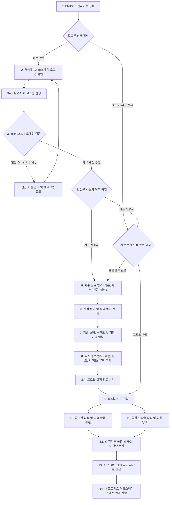

# BRIDGE — 사용자 이용 흐름도 (USER_FLOW.md)

## 1. 개요
본 문서는 경북대학교 컴퓨터학부 학생이 BRIDGE 서비스에 최초 접속하여 학교 계정으로 인증하고, 프로필 설정 후 공모전 탐색, 팀원 매칭, 팀 빌딩 및 시간표 조율을 거쳐 프로젝트를 완주하기까지의 전체적인 사용자 여정(User Journey)을 정의합니다.

---

## 2. 14단계 전체 사용자 이용 흐름

---

## 3. 단계별 상세 흐름 및 비즈니스 룰

### [Phase 1: 인증 및 접근 통제 (ACCOUNT)]
1. **서비스 최초 접속**:
   - 사용자가 플랫폼 URL에 접속하면 로컬 인증 토큰 유무를 확인합니다.
   - 인증되지 않은 사용자는 모든 내부 페이지(`/opportunities`, `/members`, `/projects` 등)에 직접 접근할 수 없으며, 독립된 로그인 페이지(`/login`)로 강제 리다이렉트됩니다.
2. **Google OAuth 간편 로그인**:
   - `Sign in with Google` 버튼을 통해 Supabase Auth의 Google OAuth 인증 팝업/리다이렉트가 실행됩니다.
   - 기존의 번거로운 이메일/비밀번호 회원가입 절차는 제공하지 않습니다.
3. **학교 이메일(`@knu.ac.kr`) 검증**:
   - Google 계정의 이메일이 `@knu.ac.kr` 도메인인지 서버(Edge Function / RLS) 및 클라이언트에서 이중 검증합니다.
   - 일반 개인 계정(`@gmail.com`) 또는 타 대학 계정인 경우 즉시 세션을 종료하고 "경북대학교 웹메일 계정으로만 접근 가능합니다"라는 경고 배너를 표시합니다.
   - *대체 수단 대비*: 만약 학교 측의 Google 외부 앱 권한 제약이 발생할 경우, 학부 이메일 인증 링크 전송 방식을 대체 수단으로 가동합니다.

---

### [Phase 2: 온보딩 및 프로필 빌딩 (ONBOARDING)]
4. **신규 사용자 분기**:
   - 데이터베이스 `profiles` 테이블에 해당 유저의 필수 프로필 레코드가 존재하는지 조회합니다.
5. **초기 프로필 설정 화면**:
   - **Step 1 (기본 정보)**: 이름, 소속 학부(컴퓨터학부 직접 입력), 세부전공(트랙), 학년 입력.
   - **Step 2 (성향 & 역할)**: 15개 관심 분야 및 11개 희망 역할 다중 선택.
   - **Step 3 (기술 스택 & 숙련도)**: 프로그래밍, 프론트엔드, 백엔드, AI 등 카테고리별 기술 스택 선택 및 기술별 숙련도(입문 / 활용 가능 / 숙련) 지정. 보유 기술이 없는 저학년 학생을 위한 **'아직 보유 기술 없음'** 선택 옵션 기본 제공.
   - **Step 4 (선택 정보 & 시간표)**: 한 줄 소개, GitHub/포트폴리오 링크, 활동 가능 시간 등록. (언제든지 건너뛰고 마이페이지에서 추후 등록 가능).
6. **설정 완료 후 대시보드 전환**:
   - 프로필 저장이 완료되면 자동으로 홈 대시보드(`/`)로 전환됩니다.

---

### [Phase 3: 기회 발견 및 팀원 연결 (WORKSPACE)]
7. **홈 대시보드 탐색**:
   - 사용자 프로필을 기반으로 맞춤 계산된 추천 공모전, 최신 학부 공식 공고, 마감 임박 공모전, 추천 팀원 목록을 한눈에 확인합니다.
8. **공모전 탐색 및 북마크**:
   - 학부 공식 공고(`knu_cse_official`), 관리자 공고(`admin_manual`), 사용자 직접 등록 공고(`user_manual`)를 검색/필터링하고 상세 페이지에서 원본 링크 확인 및 북마크를 수행합니다.
9. **팀원 모집 게시판 활용**:
   - 공모전 상세 페이지에서 바로 해당 공고를 연결하여 팀원 모집글을 작성하거나, 미등록 외부 활동/스터디 모집글을 자율 작성합니다.
   - 다른 학우의 모집글에 희망 역할과 지원 동기를 적어 가입 신청(`Application`)을 제출합니다.
10. **팀원 직접 탐색 및 매칭**:
    - 팀원 탐색 메뉴에서 이름/닉네임 검색 또는 기술 스택/학년/전공 필터링을 통해 적합한 동료를 찾고, 추천 점수와 이유를 확인한 뒤 팀 초대장(`Invitation`)을 발송합니다.

---

### [Phase 4: 스마트 협업 및 완주 (COLLABORATION)]
11. **스마트 팀 빌더 (Team Builder)**:
    - 관심 있는 팀원 후보들을 팀 빌더에 담아 다각형 레이더 차트로 팀 전체 역량을 시각화합니다.
    - 백엔드, 디자이너 등 결손 포지션이 발생하면 시스템이 보완 인재를 자동으로 추천합니다.
    - 최종 팀 구성이 완료되면 팀 데이터를 저장하고 프로젝트를 개설합니다.
12. **주간 30분 시간표 조율 (Schedule Sync)**:
    - 팀원들의 주간 활동 가능 시간표를 취합하여 5단계 히트맵을 생성합니다.
    - 알고리즘이 팀원 전원(100%) 또는 최대 인원이 참석 가능한 연속 1~2시간 최적 회의 슬롯을 도출합니다.
    - 확정된 슬롯을 팀 정기 회의(`Meeting`) 일정으로 등록합니다.
13. **내 프로젝트 워크스페이스**:
    - D-Day 카운트다운, 팀원별 역할 확인, 회의 일정, GitHub 및 Figma 링크를 공유하며 프로젝트를 완주합니다.
